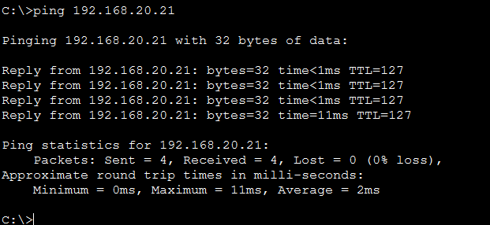

# ☕ Coffee Shop Network — Cisco Packet Tracer

**First networking portfolio project | Sambidhan Paudel**

A simulated coffee-shop LAN with **four VLANs**, router-on-a-stick inter-VLAN routing, **DHCP**, **guest isolation using an extended ACL**, and **SSH-based switch administration**. Includes the original Packet Tracer file, complete router/switch running configurations, and screenshots of **actual successful and intentionally blocked tests**.


> **Status: documented and tested in Packet Tracer.** Verified: VLANs/trunk, operational router subinterfaces, DHCP client leases, gateway connectivity, guest isolation, office-to-POS routing, switch SSH login and management gateway reachability. **Internet connectivity is not implemented or claimed**; router ISP-facing `Gi0/0` remains administratively down.

## Project objectives

- Separate **management office (VLAN 10)**, **point-of-sale (VLAN 20)** and **guest wireless (VLAN 30)** traffic.
- Use **network management VLAN 99** for switch administration.
- Implement 802.1Q trunking and Cisco router subinterfaces (router-on-a-stick).
- Automatically assign client IPv4 settings through per-VLAN DHCP pools.
- Restrict guest access to internal networks with a router extended ACL.
- Verify routing and management access with ICMP and SSH; record both permitted and denied traffic.

## At a glance

| VLAN | Purpose | Subnet | Default gateway | Switch assignment |
|:---:|---|---|---|---|
| **10** | Management Office | `192.168.10.0/24` | `192.168.10.1` | `Fa0/1–Fa0/5` |
| **20** | POS | `192.168.20.0/24` | `192.168.20.1` | `Fa0/6–Fa0/10` |
| **30** | Guest Wi-Fi | `192.168.30.0/24` | `192.168.30.1` | AP on `Fa0/11` |
| **99** | Network Management | `192.168.99.0/24` | `192.168.99.1` | Switch management SVI `192.168.99.2` |

**Switch–router trunk:** `Gi0/1` on both devices; VLANs **10, 20, 30, 99** permitted.  
**Routing:** router subinterfaces `Gi0/1.10`, `.20`, `.30` and `.99`, all verified **up/up**.  
**DHCP:** the router allocates client IP addresses, excluding `.1–.20` in VLANs 10, 20 and 30. Configured DNS option: `8.8.8.8` (no external DNS reachability test).  
**Guest policy:** inbound ACL `GUEST_RESTRICTIONS` on router `Gi0/1.30`; permits guest DHCP traffic and blocks guest-initiated IP traffic to office/POS/management subnets before allowing other guest-sourced destinations.

## Verified testing results

All images linked below are **included in this repository**. A blocked guest ping is an *expected security result*, not a failure of the project.

| ID | Test | Actual observation | Result |
|---|---|---|---|
| 01 | Switch VLANs | VLANs 10, 20, 30 and 99 shown; expected access ports present | ✅ Verified |
| 02 | Switch trunk | `Gi0/1` trunking with 802.1Q; all four VLANs allowed and forwarding | ✅ Verified |
| 03 | Switch management settings | SVI `192.168.99.2/24`, gateway `192.168.99.1` shown | ✅ Config verified |
| 04 | Router VLAN subinterfaces | `.10`, `.20`, `.30`, `.99` have correct IPs and are **up/up** | ✅ Verified |
| 05 | Router DHCP bindings | Leases `192.168.10.21`, `192.168.20.21`, `192.168.30.21`, `192.168.30.22` | ✅ Verified |
| 06 | Guest ACL | ACL rules shown; inbound application on `Gi0/1.30` shown | ✅ Verified |
| 07 | Office → office gateway | PC1 `192.168.10.21` → `192.168.10.1`: **4/4 replies** | ✅ Pass |
| 08 | POS → POS gateway | PC2 `192.168.20.21` → `192.168.20.1`: **4/4 replies** | ✅ Pass |
| 09 | Guest DHCP / gateway | Guest `192.168.30.22` by DHCP; ping `192.168.30.1`: **4/4 replies** | ✅ Pass |
| 10 | Guest → internal gateways | Guest pings to `192.168.10.1`, `.20.1`, `.99.1` return **destination host unreachable** | ✅ Isolation demonstrated |
| 11 | Office → POS client | PC1 → PC2 `192.168.20.21`: **4/4 replies** | ✅ Pass |
| 12 | SSH switch management | `ssh -l admin 192.168.99.2` reaches `CoffeeShop-SW#` | ✅ Pass |
| 13 | Switch → management gateway | `CoffeeShop-SW` → `192.168.99.1`: **5/5 replies** | ✅ Pass |

**Interpretation:** Office-to-POS traffic is intentionally allowed by this configuration. The guest ACL is not a general-purpose firewall and does not block office ↔ POS communications. Guest isolation is evidenced by failed internal-network pings *alongside* a successful guest-to-own-gateway ping. The ACL screenshot displays four DHCP permit matches, not deny-rule counters; the blocked client tests provide additional behavioural evidence.

## Selected evidence gallery

**Switch VLAN configuration**


**802.1Q trunk verification**


**DHCP lease assignments**


**Guest Wi-Fi DHCP address**


**Guest isolation — intentionally blocked**


**Permitted inter-VLAN office-to-POS routing**



**SSH login to switch**


See [SCREENSHOT-INDEX.md](SCREENSHOT-INDEX.md) for the **complete set of 15 screenshots** and [TESTING.md](TESTING.md) for every command and result.

## Open and reproduce

1. Install **Cisco Packet Tracer** via Cisco Networking Academy if necessary.
2. Open [`COFFEE.pkt`](COFFEE.pkt) in Packet Tracer.
3. Explore the router `CoffeeShop-RTR`, switch `CoffeeShop-SW`, wired clients and wireless guest laptops.
4. Use the commands in [TESTING.md](TESTING.md) to reproduce the observations.
5. For exact configurations, open [router-running-config.txt](configs/router-running-config.txt) and [switch-running-config.txt](configs/switch-running-config.txt).

### 🔑 Lab credentials (intentionally disclosed)

**All configured lab passwords are `Cisco123`**, as stated by the project author. This is an educational, deliberately public simulation. The switch SSH username is **`admin`**.

| Device/access | Username | Password |
|---|---|---|
| Router console and privileged EXEC (`enable`) | N/A | `Cisco123` |
| Switch console and privileged EXEC (`enable`) | N/A | `Cisco123` |
| Switch SSH (`ssh -l admin 192.168.99.2`) | `admin` | `Cisco123` |

Cisco IOS stores the secrets as hashes in running-config exports. **Never reuse these credentials in real deployments or other accounts.** Wireless AP settings were not independently exported; do not assume an undocumented SSID or Wi-Fi passphrase. The router's VTY login configuration is not equivalent to a verified router SSH service; the proven SSH login is to the switch.

## Repository layout

```text
coffee-shop-network-packet-tracer/
├── COFFEE.pkt
├── README.md
├── network.md
├── TESTING.md
├── configs/
│   ├── README.md
│   ├── router-running-config.txt
│   └── switch-running-config.txt
└── screenshots/
    ├── topology.png
    ├── 01-switch-vlans.png
    ├── 02-switch-trunk.png
    ├── 03-switch-management.png
    ├── 04-router-subinterfaces.png
    ├── 05-router-dhcp-bindings.png
    ├── 06-router-guest-acl.png
    ├── 07-office-gateway-ping.png
    ├── 08-pos-gateway-ping.png
    ├── 09-guest-DHCP_CONF.png
    ├── 09-guest-gateway-ping.png
    ├── 10-guest-isolation.png
    ├── 11-office-to-pos-ping.png
    ├── 12-switch-ssh.png
    └── 13-switch-management-ping.png
```

## Lessons learned and next improvements

- Designed a small-office LAN with separate business and guest segments and documented its addressing plan.
- Configured VLANs, trunking, router subinterfaces, DHCP scopes, inbound ACLs, SSH and switch management.
- Checked both **successful connections** and **expected security blocks**, rather than relying on device configuration alone.
- Next: complete an ISP uplink/NAT lab; record guest-to-public-destination tests when configured; harden management access and improve office/POS segmentation if required.

More details: [Network design](network.md) · [Verification procedures](TESTING.md) · [Skills & LinkedIn description](SKILLS.md).

**Author:** Sambidhan Paudel — Bachelor of Information and Communication Technology student.
