# Network Design & Configuration

This design record is grounded in `COFFEE.pkt`, the full [router](configs/router-running-config.txt) and [switch](configs/switch-running-config.txt) running-config exports, and the [supplied test evidence](SCREENSHOT-INDEX.md).

## 1. Scenario and topology

The simulated coffee shop has two wired business areas (management office and POS), a wireless guest area and a separate management network. A Cisco 2911 router terminates VLANs through an **802.1Q router-on-a-stick link**, while the access switch connects PCs, printers and a guest access point.

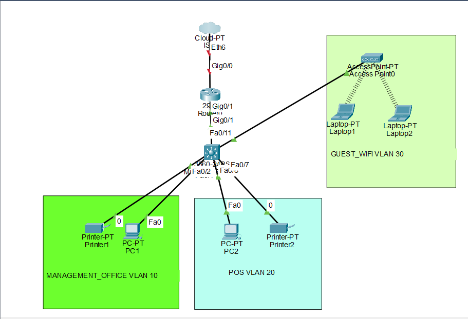

| Component | Role / verified setting |
|---|---|
| `CoffeeShop-RTR` | Cisco 2911; `Gi0/1` towards switch; four tagged IPv4 gateway subinterfaces; DHCP and guest ACL |
| `CoffeeShop-SW` | VLAN/access-port configuration, `Gi0/1` trunk, management SVI on VLAN 99; SSH v2 |
| PC1 and Printer1 | Office devices in VLAN 10 |
| PC2 and Printer2 | POS devices in VLAN 20 |
| Access Point0, Laptop1, Laptop2 | Wireless guest devices reached through switch `Fa0/11` in VLAN 30 |
| Cloud / ISP | Drawn in topology, but **not activated**: router `Gi0/0` is `shutdown`, with no IPv4 address |

Actual per-device switch port assignment is not fully established for each PC/printer by the screenshots; what is confirmed is the port *range* assigned to each access VLAN.

## 2. VLAN and IPv4 addressing plan

| VLAN | IOS name | Subnet | Router subinterface | Gateway | Switch ports |
|---|---|---|---|---|---|
| 10 | `MANAGEMENT_OFFICE` | `192.168.10.0/24` | `Gi0/1.10` | `192.168.10.1` | `Fa0/1–Fa0/5` |
| 20 | `POS` | `192.168.20.0/24` | `Gi0/1.20` | `192.168.20.1` | `Fa0/6–Fa0/10` |
| 30 | `GUEST_WIFI` | `192.168.30.0/24` | `Gi0/1.30` | `192.168.30.1` | `Fa0/11` |
| 99 | `NETWORK_MANAGEMENT` | `192.168.99.0/24` | `Gi0/1.99` | `192.168.99.1` | SVI `Vlan99` on switch |

- The switch management SVI uses `192.168.99.2 255.255.255.0`; default gateway is `192.168.99.1`.
- Subnet mask throughout is `255.255.255.0` (**/24**).
- VLAN 99 is carried on the trunk to reach the router, even though `show vlan brief` does not list dedicated physical access ports for VLAN 99.
- VLAN 1 remains a default VLAN for unused ports; router and switch `interface Vlan1` are shut down.

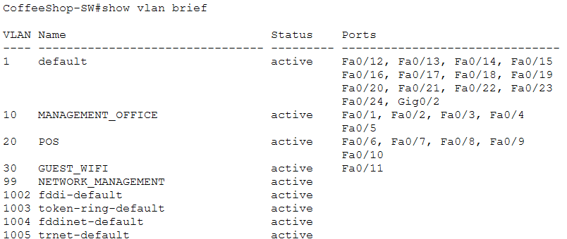

## 3. Switching and trunking

`CoffeeShop-SW` places office devices on access ports `Fa0/1–Fa0/5`, POS on `Fa0/6–Fa0/10`, and the access point on `Fa0/11`. `spanning-tree portfast` is set on these endpoint ports. PVST is configured as spanning-tree mode.

The switch `Gi0/1` uplink:

```cisco
interface GigabitEthernet0/1
 description TO_COFFEESHOP_RTR
 switchport trunk allowed vlan 10,20,30,99
 switchport trunk encapsulation dot1q
 switchport mode trunk
```

Runtime evidence from `show interfaces trunk` confirms **802.1Q**, status **trunking**, and VLANs **10,20,30,99** active/forwarding. Native VLAN remains **1**.

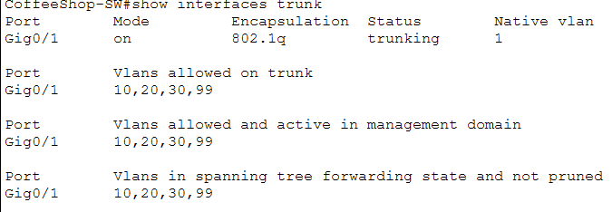

## 4. Router-on-a-stick and inter-VLAN routing

The router uses `Gi0/1` as the parent Ethernet link with four 802.1Q subinterfaces:

```cisco
interface GigabitEthernet0/1.10
 encapsulation dot1Q 10
 ip address 192.168.10.1 255.255.255.0
interface GigabitEthernet0/1.20
 encapsulation dot1Q 20
 ip address 192.168.20.1 255.255.255.0
interface GigabitEthernet0/1.30
 encapsulation dot1Q 30
 ip address 192.168.30.1 255.255.255.0
 ip access-group GUEST_RESTRICTIONS in
interface GigabitEthernet0/1.99
 encapsulation dot1Q 99
 ip address 192.168.99.1 255.255.255.0
```

The `show ip interface brief` screenshot proves all four subinterfaces are **up/up**. PC1 successfully pings PC2 at `192.168.20.21` (4/4 replies), verifying an actual **office → POS** routed path.

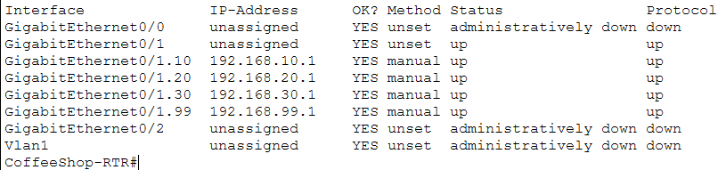

## 5. DHCP and observed clients

Three router DHCP pools (`MANAGEMENT_OFFICE`, `POS`, `GUEST_WIFI`) match subnets `192.168.10.0/24`, `192.168.20.0/24`, and `192.168.30.0/24`. Each pool supplies its own router gateway as `default-router`, and uses DNS option `8.8.8.8`.

```cisco
ip dhcp excluded-address 192.168.10.1 192.168.10.20
ip dhcp excluded-address 192.168.20.1 192.168.20.20
ip dhcp excluded-address 192.168.30.1 192.168.30.20
```

| Observed IPv4 assignment | Device/context | Evidence |
|---|---|---|
| `192.168.10.21` | Office PC1, DHCP | [Office ipconfig](screenshots/07-office-gateway-ping.png) |
| `192.168.20.21` | POS PC2, DHCP | [POS ipconfig](screenshots/08-pos-gateway-ping.png) |
| `192.168.30.21` | Another guest DHCP client (device not identified from lease screenshot) | [DHCP bindings](screenshots/05-router-dhcp-bindings.png) |
| `192.168.30.22` | Guest laptop DHCP settings | [Guest IP configuration](screenshots/09-guest-DHCP_CONF.png) |

The router lease listing shows these four active bindings:

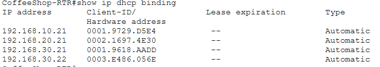

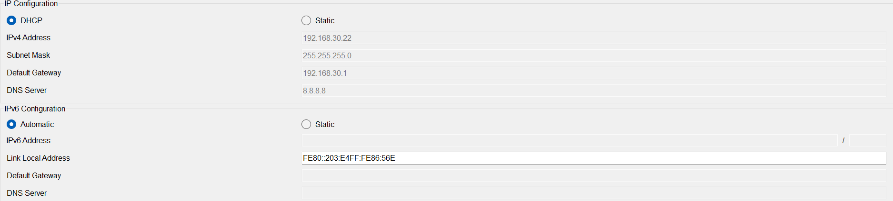

These prove **address allocation inside the simulated LAN**, not internet connectivity or successful external DNS resolution.

## 6. Guest access-control policy

Extended ACL `GUEST_RESTRICTIONS` is bound **inbound** on router subinterface `Gi0/1.30`:

```cisco
ip access-list extended GUEST_RESTRICTIONS
 permit udp any eq bootpc any eq bootps
 deny ip 192.168.30.0 0.0.0.255 192.168.10.0 0.0.0.255
 deny ip 192.168.30.0 0.0.0.255 192.168.20.0 0.0.0.255
 deny ip 192.168.30.0 0.0.0.255 192.168.99.0 0.0.0.255
 permit ip 192.168.30.0 0.0.0.255 any
```

**What is verified:**

- Guest has `192.168.30.22/24` assigned and reaches its own gateway `192.168.30.1` (4/4 pings).
- Guest attempts to ping office gateway `192.168.10.1`, POS gateway `192.168.20.1` and management gateway `192.168.99.1` each return `Reply from 192.168.30.1: Destination host unreachable` in the supplied evidence.
- Runtime `show ip interface Gi0/1.30` reports inbound ACL `GUEST_RESTRICTIONS`.

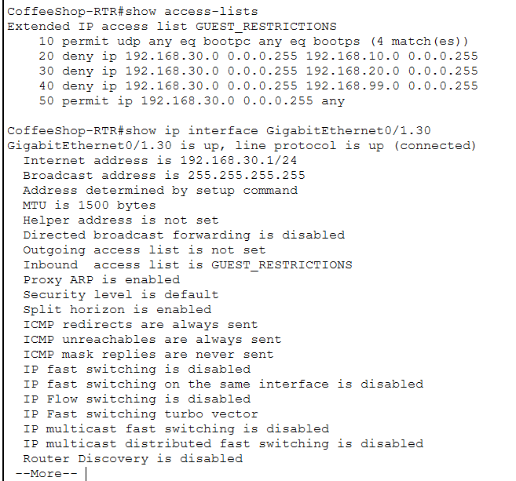

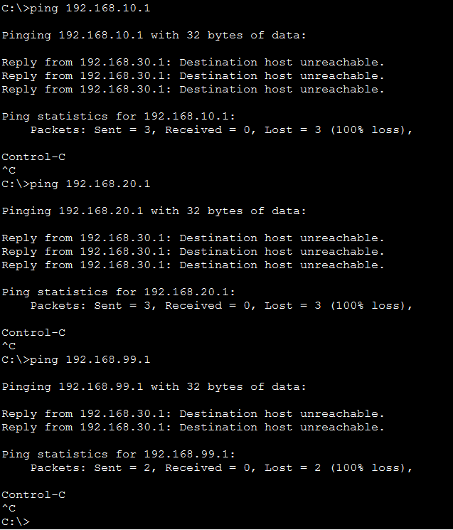

**Policy scope:** This restricts guest-originated traffic to the listed internal /24 networks. It is **not** a blanket prohibition on routing between office and POS, as the successful PC1 → PC2 ping demonstrates. The ACL display shows four DHCP permit matches but does **not** show nonzero counters for denied traffic; client ping outcomes and configured ACL placement support the guest-isolation demonstration.

## 7. Switch management and SSH

Switch settings include:

```cisco
interface Vlan99
 description SWITCH_MANAGEMENT
 ip address 192.168.99.2 255.255.255.0
ip default-gateway 192.168.99.1
ip ssh version 2
username admin privilege 15 secret 5 [Cisco stored hash]
line vty 0 4
 login local
 transport input ssh
```

- A PC reaches `CoffeeShop-SW#` with `ssh -l admin 192.168.99.2` using the lab credentials.
- The switch pings router management gateway `192.168.99.1` with **5/5 replies (100%)**.
- Switch console, enable and SSH credentials are described in [README.md](README.md#-lab-credentials-intentionally-disclosed); **all lab passwords are `Cisco123`**, SSH username `admin`.
- The actual original full configs are preserved; the snippet above deliberately replaces one hash with a placeholder for readability only.

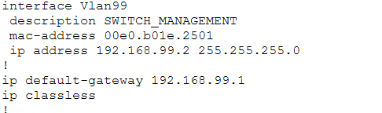

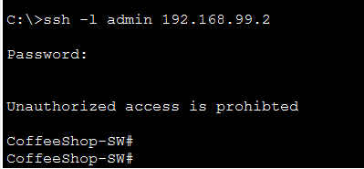

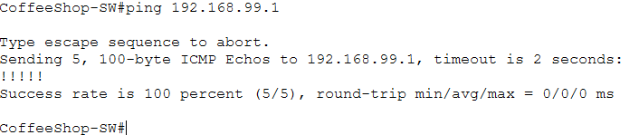

## 8. Internet/WAN boundary

Router `Gi0/0` is named `TO_ISP` but is **administratively down with no IPv4 address**. The shown configurations do not demonstrate default-route or NAT/PAT internet connectivity. The cloud icon in the diagram only represents a potential future extension.

## 9. Testing and next iteration

Detailed exact commands, screenshots and pass criteria are in [TESTING.md](TESTING.md).

Potential improvements: complete the ISP uplink/NAT/PAT as a separately tested task; add tests between guest laptop and actual office/POS *hosts* in addition to gateways; document AP wireless configuration; tighten office-to-POS access if required; and use unique strong management credentials for any non-lab deployment.
